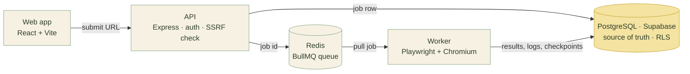

<div align="center">


<a href="https://github.com/Ruchitra-Jasmatiya/No_bug">
  
</a>

### Submit a URL. A real browser tests it. You get a report with evidence, severity and fixes.


[**Quick start**](#-quick-start) &nbsp;·&nbsp; [**How it works**](#-how-it-works) &nbsp;·&nbsp; [**What it tests**](#-what-it-tests) &nbsp;·&nbsp; [**API**](#-api) &nbsp;·&nbsp; [**Deploy**](#-deploying) &nbsp;·&nbsp; [**Status**](#-project-status)

</div>

<br/>

## ✨ What is this?

**NO BUGS ALLOWED** is a website testing platform. Paste in a URL and a background worker drives a **real Chromium browser** against it, runs a suite of checks, and hands back a report that shows exactly what it found, how serious it is, and how to fix it. The built-in assistant is called **BUGSY**.

- 🔎 **Evidence, not guesses.** Every finding is something the tester actually observed: a failed request, a console error, a missing header, a broken link.
- 🧭 **Severity and recommended fixes** on every bug, with filters, copy-able fixes and a PDF export.
- ⚡ **Fast.** Modules run in parallel (`MODULE_CONCURRENCY`, default 5), with live progress, per-test status and an activity log.
- 💥 **Crash-safe.** Progress is checkpointed in PostgreSQL. If a worker dies mid-test, another one picks the job up and runs only the unfinished modules.
- 🤖 **BUGSY.** Ask questions about your results. It works with no AI key at all (it answers from stored test evidence) and uses an AI model when you configure one.
- 🔒 **Safe by design.** SSRF protection, a guarded browser proxy, no granted permissions, passive and non-destructive checks only.

> [!IMPORTANT]
> Only test sites you own or are authorised to test. The app asks every user to confirm this before a test starts.

<br/>

## 🧠 How it works



- **The database is the source of truth.** Job state, module checkpoints, results and logs live in PostgreSQL. Redis only carries "please run job X". If Redis is wiped, the worker's reaper re-enqueues from the database.
- **Recovery.** Each module's outcome is saved in a single transaction. After a crash, another worker claims the job once its heartbeat goes stale and runs only the unfinished modules. Finished modules are never rerun.
- **Browser isolation.** Chromium is launched through a local guarded proxy that resolves and validates every destination at connection time (this defeats DNS rebinding). It allows only ports 80, 443, 8080 and 8443, grants no permissions (camera, microphone, location, clipboard), and blocks service workers and downloads.

### 🪞 Honesty rules, enforced in code

> [!NOTE]
> A testing tool is only useful if you can trust its "all clear". These rules are built into the code, not just the docs.

| Rule | What it means |
|---|---|
| **Skipped is not passed** | A skipped or blocked module is never counted as a pass. |
| **Incomplete runs are flagged** | If a selected module was skipped, blocked or failed, the whole run is marked *incomplete*. |
| **No "bug-free" claims** | A clean report says *"No issues detected in the tests performed."* and nothing stronger. |
| **AI can't rewrite the evidence** | AI output is stored separately. It can never change evidence, severity, confidence or status. |
| **BUGSY won't invent answers** | With AI off it says so and still shows real test data. |

<br/>

## 🔍 What it tests

Every module reports what it actually observed. A check that doesn't apply (for example, pagination on a page without any) is reported as **skipped (not applicable)**, never as a pass.

| Module | What it looks at |
|---|---|
| ♿ **Accessibility** | Keyboard navigation and visible focus, plus checks on the rendered page |
| 🔐 **Security** | Transport, security headers, information disclosure, CORS, cookies, and exposed sensitive paths (verified by content signature, so a generic 200 page isn't misreported) |
| 🔗 **Links & images** | Broken links and images |
| 🗺 **Site pages & URL validation** | Crawls same-site pages linked from the start page and reports what each URL returned. Plain `GET` only; action-like links (log out, delete, unsubscribe) are never requested |
| 📄 **Pagination** | Pager controls, the chain of "next" links, and a real click on "Load more" style buttons |
| 📱 **Responsive** | Multiple viewports measured at once, each in an isolated browser context, including the viewport meta tag |
| 🎨 **UI & layout** | Clipped or overflowing content, overlapping text blocks, layout shift |
| 👁 **Visual regression** | Compares against a stored baseline. The first run records the baseline and reports *info*, not a pass |
| ⚙️ **Functional** | Interactive elements and tabs; forms are inspected, never submitted. Permission-gated features are reported as *blocked* |
| 🧯 **Console & network** | Console errors and failed network requests |
| 🔌 **API calls** | The XHR/fetch calls the page makes on its own while loading. Nothing is invented or replayed |
| 🚀 **Performance** | Page load and performance measurements |
| 📦 **PWA** | Service worker and installability signals (Chromium) |
| 🔎 **SEO** | `robots.txt`, sitemap and on-page SEO |
| 🤖 **AI analysis** | Plain-language explanations of bugs the tests really found. Skipped, and reported as skipped, when no AI is configured |

<br/>

## 🚀 Quick start

**Requirements:** Node 22+, Docker (for Redis), a PostgreSQL database (Supabase or local), Chrome or Chromium.

```bash
# 0. get the code
git clone https://github.com/Ruchitra-Jasmatiya/No_bug.git
cd No_bug

# 1. install
npm install
npx playwright install chromium          # or set CHROME_EXECUTABLE_PATH to a system Chrome

# 2. configure
cp .env.example .env                     # then edit .env (see "Environment variables")

# 3. Redis
docker compose up -d redis

# 4. database (see "Database setup" below), then:
npm run db:migrate

# 5. run (three terminals)
npm run dev:api                          # http://localhost:4000/healthz
npm run dev:worker
npm run dev:web                          # http://localhost:5173 (proxies /api to :4000)

# 6. verify
npm run typecheck && npm test
```

Prefer containers? `docker compose up --build` starts the API on `:4000`, the worker and Redis.

<details>
<summary><b>🗄 Database setup</b></summary>

<br/>

**Supabase (recommended, and used in production)**

1. Create a project at [supabase.com](https://supabase.com).
2. Project Settings → Database → copy the connection string into `SUPABASE_DB_URL`.
3. Project Settings → API → copy the project URL into `SUPABASE_URL`.
4. Run `npm run db:migrate`. It applies `supabase/migrations/*.sql` in order, is idempotent, and records what it has applied in `schema_migrations`.
5. Grant yourself admin once, in the SQL editor:

```sql
insert into public.user_roles (user_id, role) values ('<your auth.users id>', 'admin');
```

**Plain local PostgreSQL (no Supabase)**

```bash
SUPABASE_DB_URL=postgresql://postgres@localhost:5432/nba npm run db:migrate:local
```

This first applies `supabase/local/00_auth_stub.sql`, which recreates the minimal `auth` schema and roles. **Never run that file against Supabase.**

</details>

<details>
<summary><b>🔧 Environment variables</b></summary>

<br/>

See [`.env.example`](.env.example) for the full list.

- Secrets (`SUPABASE_DB_URL`, `SUPABASE_JWT_SECRET`, `REDIS_URL`, `SESSION_SECRET`, `RESEND_API_KEY`, `AI_API_KEY`) are **server-side only**.
- Browser variables must start with `VITE_` and are public. Never put a secret in one.
- `ADMIN_NOTIFICATION_EMAIL` is never hardcoded; the address is read only from that variable.
- **Email:** create a [Resend](https://resend.com) account, verify a sending domain, then set `RESEND_API_KEY` and `EMAIL_FROM`. Without them the API cannot send sign-up codes. It fails loudly and never silently drops or logs a code.
- **AI / BUGSY:** set `AI_API_KEY` (and optionally `AI_PROVIDER`, `AI_MODEL`) on **both** the API and the worker. Without it everything still works and the UI says AI is off.
- **Database TLS:** if your provider's certificate chain is rejected by Node, set `DB_SSL_REJECT_UNAUTHORIZED=false`. It is strict by default.

</details>

<br/>

## 🔌 API

All `/api/tests*` routes require `Authorization: Bearer <access token>`.

<details>
<summary><b>Tests</b></summary>

<br/>

| Method | Path | Purpose |
|---|---|---|
| `POST` | `/api/tests` | Create a test `{ url, authorizationConfirmed: true, modules?, idempotencyKey? }` → 202 |
| `GET` | `/api/tests` | List my tests (`page`, `pageSize`) |
| `GET` | `/api/tests/active` | My unfinished tests (restores a session after a refresh or reopened browser) |
| `GET` | `/api/tests/:id` | One test |
| `GET` | `/api/tests/:id/progress?after=<logCursor>` | Real progress: job, per-module state, counts, new logs |
| `GET` | `/api/tests/:id/results` | Every test with its real status, duration, counts and per-check results |
| `POST` | `/api/tests/:id/resume` | Make a failed test runnable again from its checkpoints |
| `POST` | `/api/tests/:id/restart` | New test for the same URL; the old active one is cancelled |
| `POST` | `/api/tests/:id/cancel` | Cancel (immediately if queued, at the next heartbeat if running) |
| `GET` | `/api/tests/:id/report` | Full report (409 until finished) |
| `GET` | `/api/tests/:id/bugs?severity=&category=` | Bug reports |
| `GET` | `/api/modules` | Which modules exist, are implemented and are enabled |
| `GET` | `/healthz` | Database and Redis health |

</details>

<details>
<summary><b>Authentication</b></summary>

<br/>

| Method | Path | Purpose |
|---|---|---|
| `POST` | `/api/auth/signup` | `{ fullName, email, phone?, password, confirmPassword, termsAccepted: true }` → 202, emails a 6-digit code |
| `POST` | `/api/auth/verify-otp` | `{ email, code }` → marks the email verified (no sign-in before this) |
| `POST` | `/api/auth/resend-otp` | `{ email, purpose? }` (60 s cooldown, 6 codes per hour) |
| `POST` | `/api/auth/login` | `{ email, password }` → `{ accessToken, user }` + HttpOnly refresh cookie |
| `POST` | `/api/auth/refresh` | Rotates the refresh cookie (needs header `X-Requested-With: nba-web`) |
| `POST` | `/api/auth/logout` | Revokes the session and clears the cookie |
| `POST` | `/api/auth/forgot-password` | `{ email }` → always the same response (no account enumeration) |
| `POST` | `/api/auth/reset-password` | `{ email, code, newPassword, confirmPassword }` → signs out every other session |
| `GET` | `/api/auth/me` | The signed-in user |

Also available: `/api/chat/*` (BUGSY status, conversations, messages) and `/api/admin/*` (overview, analytics, system, users, tests, security, audit logs, emails, settings; admin only).

</details>

<br/>

## 🔒 Security

- **Codes:** random, stored only as a keyed hash, expire in 10 minutes, single use, die after 5 wrong guesses, rate-limited.
- **Sign-in:** wrong-password and unknown-email responses are identical. Failed attempts trigger progressive delays (5 s doubling up to 15 min) that expire on their own, never a permanent lock.
- **Sessions:** refresh tokens rotate, and replaying an old one revokes the whole session. The refresh token is HttpOnly + SameSite=Lax and never appears in a response body. Suspended accounts can't sign in or refresh.
- **Authorisation:** admin access is decided from `public.user_roles` on the server and in RLS, never from a client-supplied claim. Test results are readable only by their owner, and another user's id returns an identical 404.
- **Monitoring:** more than 10 failed logins in 15 minutes (configurable) creates a security event and emails `ADMIN_NOTIFICATION_EMAIL`, once per subject per window.
- **AI prompts:** site-controlled text is sent to the model only inside delimited, sanitised, secret-redacted blocks.
- **Passwords:** handled by Supabase Auth in production. This codebase never stores a plaintext password or code.

<br/>

## 🚢 Deploying

| Part | Where | Notes |
|---|---|---|
| **Web** | Vercel | Import the repo (root directory = repo root; `web/vercel.json` is picked up) and set the `/api` rewrite to your API domain. Cookies stay same-origin, so no `VITE_` variable is needed |
| **API** | Railway or Render, `api/Dockerfile` | `SUPABASE_DB_URL`, `REDIS_URL`, `SUPABASE_URL`, `CORS_ORIGINS=https://<your-vercel-domain>`, `TRUST_PROXY=1` |
| **Worker** | Railway or Render, `worker/Dockerfile` | Never Vercel: browser tests are long-running. Build context = repo root. Set `SUPABASE_DB_URL`, `REDIS_URL` (Upstash `rediss://…`), `NODE_ENV=production`, `PORT`. Give it at least 2 GB RAM. Scale by adding instances; jobs are claimed atomically, so workers never double-run a job |

> [!WARNING]
> **Isolate the worker's network.** It runs untrusted websites in a browser. Apply an egress firewall that blocks private ranges and your cloud metadata service. The application layer already blocks them, but defence in depth is part of the design. Never give the worker credentials beyond the database URL and Redis URL.

<br/>

## 🧪 Testing

```bash
npm test                         # shared + api + worker (DB-backed suites skip without TEST_DATABASE_URL)

# include RLS, API and worker end-to-end tests
TEST_DATABASE_URL=postgresql://postgres@127.0.0.1:5432/nba_test npm test

npm run build -w web

# SIGKILL recovery + the built web app in a real browser
TEST_DATABASE_URL=... TEST_REDIS_URL=redis://127.0.0.1:6379 \
CHROME_EXECUTABLE_PATH=/path/to/chrome npm run test:e2e
```

A database-backed suite that can't reach a database reports **skipped**, never passed. Real-site timing depends on the target and your worker machine; benchmark with `worker/bench/bench.ts`.

<br/>

## 📁 Project structure

```text
No_bug/
├── shared/      types, schemas and the SSRF protection library
├── api/         Express API: auth, tests, BUGSY chat, admin
├── worker/      Playwright engine and the test modules (worker/src/modules)
├── web/         React + Vite frontend
├── supabase/    SQL migrations
├── scripts/     migration runner
└── e2e/         full-system and real-browser tests
```

<br/>

## ✅ Project status

All phases are built and verified **locally**. [`STATUS.md`](STATUS.md) has the full, honest breakdown. In short:

- [x] Unit and integration tests across `shared`, `api`, `worker` and `web`
- [x] Full-system test: API → Redis → worker → Chromium → Postgres, including SIGKILL mid-test and resume on a second worker
- [x] The built web app exercised in real Chrome: sign-up, OTP, login, live test, report, PDF, BUGSY, admin protection, mobile layout
- [ ] Verified against real **Supabase**, **Resend**, **Upstash** and the **Anthropic API** accounts
- [ ] Verified on Railway, Render and Vercel deployments, and via `docker build`
- [ ] Browsers other than Chrome and real-device mobile testing
- [ ] Load and scale testing

**Known limitations:** tests are passive (no authenticated crawling, no real-data form submission, no destructive actions). No CAPTCHA provider is integrated. Admin settings are edited as validated JSON. The Terms and Privacy pages are starter templates, not legal advice.

<br/>

## 🤝 Contributing

Issues and pull requests are welcome. Before opening a PR, please run:

```bash
npm run typecheck && npm test
```

<br/>

<div align="center">

**If this project helps you, a ⭐ on GitHub means a lot.**

Built by [**Ruchitra Jasmatiya**](https://github.com/Ruchitra-Jasmatiya)


</div>
