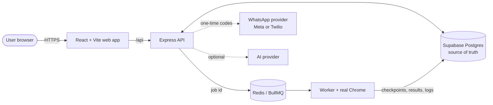

<div align="center">



<br/>


### Honest front-end testing for any website. Paste a URL, get an evidence-backed report in minutes.

[Quick start](#-quick-start) · [How it works](#-how-it-works) · [What gets tested](#-what-gets-tested) · [Admin panel](#-admin-panel) · [WhatsApp sign-up](#-whatsapp-sign-up) · [Deploy](#-deploying)

</div>

---

## Why this exists

Most "website checkers" return a score and a vague list. **NO BUGS ALLOWED** works like a QA engineer: a real Chrome browser opens
your site, every check records what it saw (page, element, status code, console line), and the report says exactly **which test ran,
on which page, whether it passed, what failed, why, and how to fix it**. Its assistant, **BUGSY**, explains any finding in plain language.

> **Honesty rules, enforced in code**
> - A test that did not run is never counted as passed. Timed-out tests are retried once, then shown as *did not finish*.
> - A report that is missing tests can never read as clean: it shows `Coverage: X of Y tests finished`.
> - It says *"No issues detected in the tests performed"*, never *"bug-free"*.
> - A file or line number is only shown when the test actually recorded one. BUGSY never invents it.
> - Identical, unchanged pages give identical findings (covered by an automated consistency test).

## Highlights

| | |
|---|---|
| **Fast** | Tests run in parallel (`MODULE_CONCURRENCY`, default 5), viewports and probes run concurrently, shared page downloads are cached per run. Typical target: 1 to 2 minutes. |
| **Transparent** | A *Tests performed* side panel lists every test with its real status, duration and counts. Open one to see each check, its URL, evidence and fix. |
| **Colour-coded** | Green = passed, red = failed, orange = warning, grey = not run. |
| **BUGSY assistant** | Answers from your stored test evidence, with or without an AI key. With a key it adds AI explanations and falls back to the built-in assistant on any failure. |
| **WhatsApp sign-up** | Contact and WhatsApp numbers at sign-up, one-time codes delivered on WhatsApp, login with email or phone. |
| **Admin panel** | Users, logins, every test, most-tested sites, security events, email log and live settings that change what users see. |
| **Safe** | Private networks blocked (SSRF-proof, DNS-rebinding-proof), passive non-destructive tests, hashed one-time codes, rotating refresh tokens. |

## 🧪 What gets tested

Front end only. Your backend is never probed or modified.

| Area | Checks |
|---|---|
| Connectivity | DNS, HTTP status, HTTPS, redirects, content type, bot-protection detection |
| Page inspection and console | Real browser load, JavaScript errors with source and line when recorded, failed requests |
| **Pagination** | Numbered links, next/previous, `rel=next`, broken page links, identical content between pages, loops, "load more" buttons really clicked |
| **Site pages and URLs** | Internal pages respond, 4xx/5xx, missing and duplicate titles, slow pages, redirect chains, `noindex` |
| **Images and links** | Broken images and broken links |
| UI and responsive | Layout problems and layouts at several viewport sizes |
| Functional | Forms, buttons, navigation, passive interaction probes |
| Accessibility | axe-core rules, labels, contrast, landmarks |
| SEO | Title, description, canonical, headings, structured data |
| Performance | Load timing, resource weight, render-blocking resources |
| Security (passive) | Headers, cookies, exposed files |
| Visual regression and PWA | Screenshot comparison against the previous run, manifest and service worker |

The set of enabled tests, timeouts and crawl limits is controlled from the admin panel.

## 🏗 How it works



- **The database is the source of truth.** Redis only carries "please run job X". If Redis is wiped, the worker's reaper re-enqueues from the database.
- **Parallel scheduler.** Gate tests (connectivity, browser launch, page inspection) run first in order, the middle tests run in a pool, AI analysis and the report run last.
- **Recovery.** Each test's outcome is saved in one transaction. After a crash another worker resumes only the unfinished tests.
- **Browser isolation.** Chromium goes through a guarded proxy that validates every destination at connection time, allows only ports 80/443/8080/8443, and grants no permissions.

Folders: `shared/` (types, schemas, SSRF library, built-in assistant) · `api/` (Express) · `worker/` (Playwright engine and test modules) · `web/` (React) · `supabase/` (migrations) · `scripts/` · `e2e/` · `docs/`.

## 🚀 Quick start

Requirements: **Node 22+**, a **PostgreSQL** database (Supabase or local), **Redis**, **Google Chrome**.

```bash
npm install
npm run build:shared
cp .env.example .env            # fill in the values, see "Configuration"
node --env-file=.env scripts/migrate.mjs
```

Run three processes (three terminals):

```bash
npm run dev:api       # http://localhost:4000/healthz
npm run dev:worker    # runs the tests
npm run dev:web       # http://localhost:5173
```

> Run the API and the worker with **`PORT` unset** in `.env` (the API defaults to 4000). If both read the same `PORT`, the worker crashes with `EADDRINUSE`.

Open http://localhost:5173. You land on the sign-in page; create an account, verify with the code, then paste a URL.

**Trying it without a WhatsApp account:** set `WHATSAPP_PROVIDER=console` in `.env` (development only). The 6-digit code is printed in the API terminal.

**Make yourself an admin** (after signing up):

```bash
node --env-file=.env scripts/make-admin.mjs you@example.com
```

Log out and in again, then open `/admin`.

## ⚙️ Configuration

See [`.env.example`](.env.example) for every variable with comments. The important ones:

| Variable | Purpose |
|---|---|
| `SUPABASE_DB_URL`, `SUPABASE_URL`, `SUPABASE_ANON_KEY`, `SUPABASE_SERVICE_ROLE_KEY` | Database and authentication |
| `REDIS_URL` | Job queue (Upstash `rediss://...` works) |
| `SESSION_SECRET` | 32+ random characters |
| `WHATSAPP_PROVIDER` | `meta`, `twilio`, or `console` (dev only) plus that provider's credentials |
| `RESEND_API_KEY`, `EMAIL_FROM` | Account and admin notification emails (the code fallback for accounts without a WhatsApp number) |
| `ADMIN_NOTIFICATION_EMAIL` | Where security alerts are sent. Never hard-coded |
| `MODULE_CONCURRENCY` | Tests run in parallel inside one run (1 to 8, default 5) |
| `CHROME_EXECUTABLE_PATH` | Path to Chrome if Playwright's browser is not installed |
| `DB_SSL_REJECT_UNAUTHORIZED` | Set `false` only if your provider's certificate chain is rejected |
| `ANTHROPIC_API_KEY` | Optional AI explanations. BUGSY works without it |

## 💬 WhatsApp sign-up

1. The sign-up form asks for name, email (stored for records only), **contact number** and **WhatsApp number** (international format, e.g. `+91 98765 43210`).
2. A 6-digit one-time code is sent to the WhatsApp number. Codes are random, stored only as a keyed hash, expire in 10 minutes, work once, die after 5 wrong guesses and are rate-limited per number and per IP.
3. After verification the user signs in with **email or phone number** plus password. Password reset codes also go to WhatsApp.
4. Accounts that have no WhatsApp number (for example an old admin account) fall back to email codes.

Providers: **Meta WhatsApp Business Cloud API** (needs an approved authentication template whose body takes one variable) or **Twilio WhatsApp**.

## 🛡 Admin panel

`/admin`, visible only to accounts with the admin role. The role is checked on the server for every `/api/admin` request, in the database, never from a client claim.

| Tab | What you can do |
|---|---|
| Overview | Users, signups, tests per day, severities, categories, **most tested websites** |
| Users | Search by name, email or phone, see contact and WhatsApp numbers, suspend, change roles |
| Tests | Every test from every user, with its URL, owner and status |
| Security and Audit log | Sign-in history, failed attempts, security events and the audit log |
| Emails | Every email sent and its delivery status |
| Settings and System | Enabled tests, timeouts, crawl limits (applied to the next test and shown to users) and queue and system health |

## 🔌 API

| Method | Path | Purpose |
|---|---|---|
| POST | `/api/auth/signup` | `{ fullName, email, phone, whatsapp, password, confirmPassword, termsAccepted: true }` sends a WhatsApp code |
| POST | `/api/auth/verify-otp` | `{ email, code }` |
| POST | `/api/auth/resend-otp` | `{ email, purpose? }` |
| POST | `/api/auth/login` | `{ email (or phone), password }` returns `{ accessToken, user }` plus an HttpOnly refresh cookie |
| POST | `/api/auth/forgot-password`, `/reset-password` | code via WhatsApp |
| GET | `/api/auth/me` | the signed-in user |
| POST | `/api/tests` | start a test `{ url, authorizationConfirmed: true, modules?, idempotencyKey? }` |
| GET | `/api/tests/:id`, `/progress`, `/results`, `/report` | live and final results |
| GET | `/api/modules` | the enabled tests |
| POST | `/api/chat/...` | BUGSY conversations |

## Deploying

**Worker → Railway or Render** (never Vercel — browser tests are long-running)
1. Create a service from this repo using `worker/Dockerfile` (build context = repository root).
2. Set `SUPABASE_DB_URL`, `REDIS_URL` (Upstash `rediss://…`), `NODE_ENV=production`, `PORT` (Render needs one; `/healthz`).
3. Give it ≥ 2 GB RAM. Scale by adding instances: jobs are claimed atomically, so workers never double-run a job.
4. **Network isolation (important):** the worker runs untrusted websites in a browser. Apply an egress firewall that
   blocks private ranges and your cloud metadata service. The application layer already blocks them, but defence in
   depth is part of the design. Never give the worker credentials beyond the database URL and Redis URL.

**API → Railway/Render** using `api/Dockerfile`: `SUPABASE_DB_URL`, `REDIS_URL`, `SUPABASE_URL`, `CORS_ORIGINS=https://<your-vercel-domain>`, `TRUST_PROXY=1`.

## ✅ Testing

```bash
npm run typecheck
TEST_DATABASE_URL=postgresql://postgres@127.0.0.1:5432/nba_test \
TEST_REDIS_URL=redis://127.0.0.1:6379 \
CHROME_EXECUTABLE_PATH=/usr/bin/google-chrome \
npm test && npm run build -w web && npm run test:e2e
```

Unit and integration suites cover the shared library, the API (auth, WhatsApp flow, admin, chat), the worker (every module, pagination, site pages, **result consistency across repeated runs**) and a real-browser end-to-end flow (sign-up, WhatsApp code, login, live test, refresh protection, report, BUGSY, admin guard, mobile layout). A DB-backed suite that cannot reach a database reports **skipped**, never passed.

## Security notes
- Passwords are handled by Supabase Auth (production); OTPs are hashed. This codebase never stores a plaintext password or code.
- Admin access is decided from `public.user_roles` on the server and in RLS, never from a client-supplied claim.
- Test results are only readable by their owner (RLS and API ownership checks). Another user's id returns an identical 404.
- Users must confirm they are authorised to test a target. Testing is passive and non-destructive.

## 📄 Docs

[STATUS.md](STATUS.md) lists exactly what was verified and what could not be verified in the build environment (real Supabase, Resend, Upstash, WhatsApp and AI providers, and real-website timings).

<div align="center"><sub>Built so that "all green" actually means all green.</sub></div>
